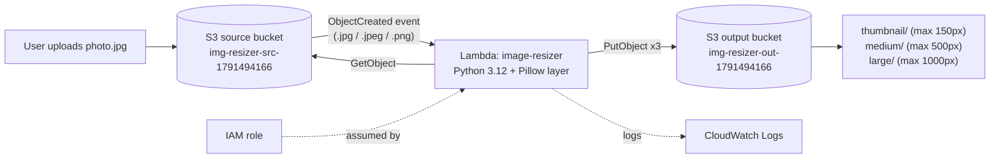
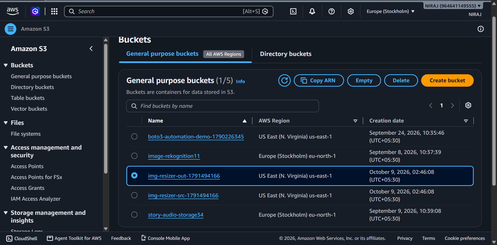
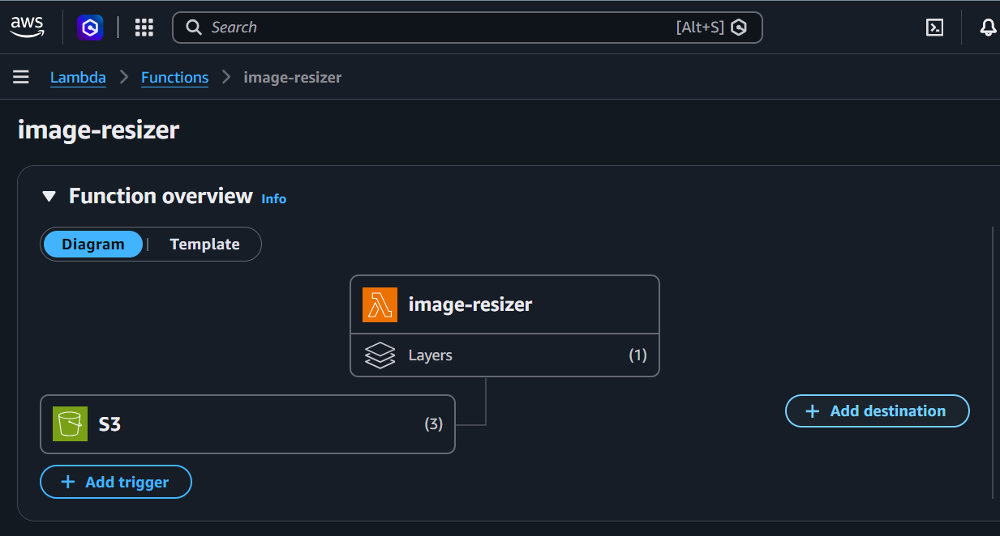
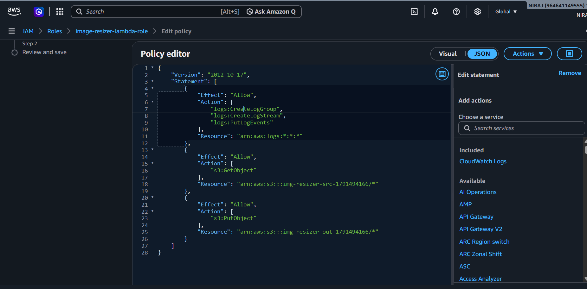
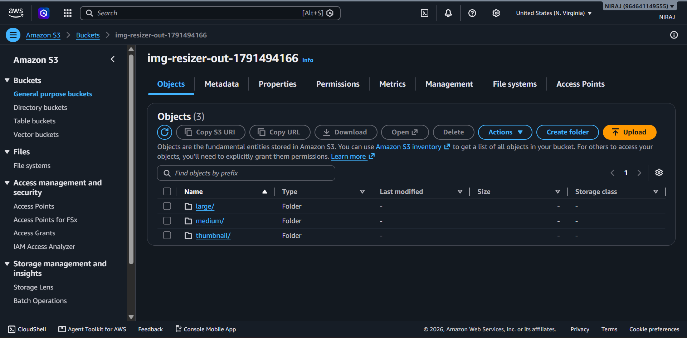
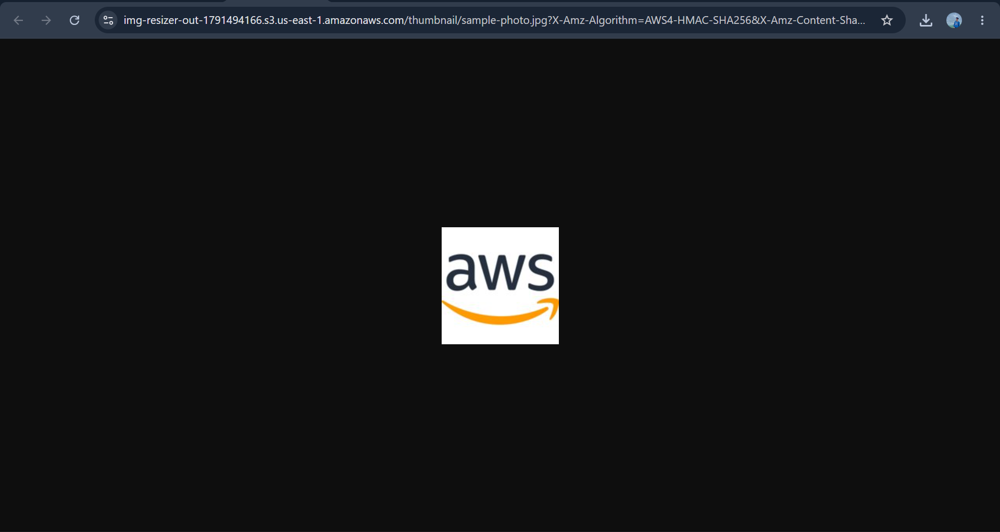
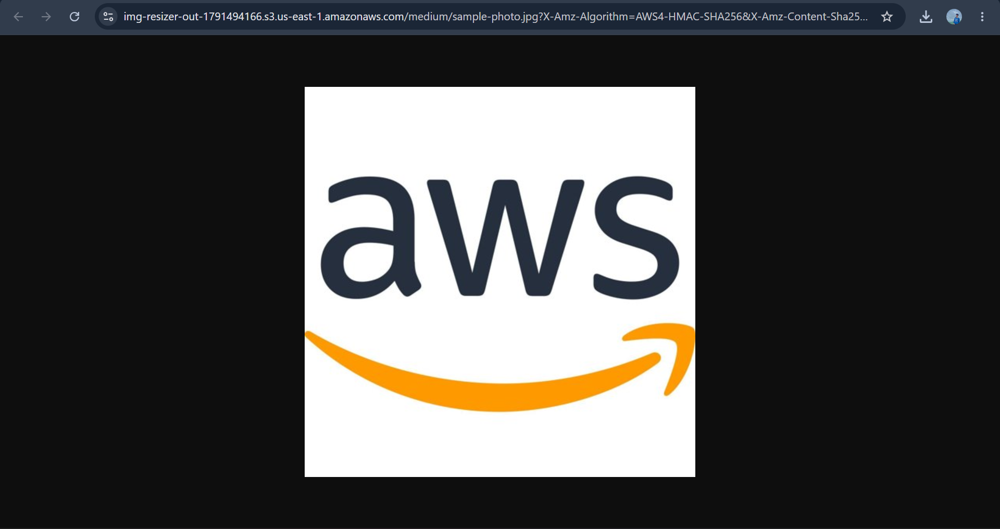
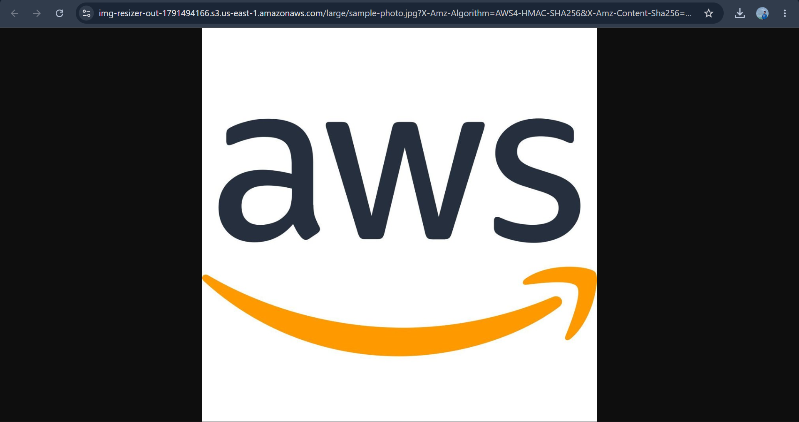
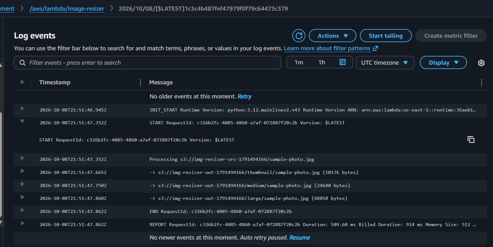

# Serverless Image Resizer on AWS (S3 + Lambda)

A serverless, event-driven image resizer. Uploading a `.jpg`, `.jpeg` or `.png` to an
S3 **source** bucket automatically triggers a Python Lambda function, which writes
**thumbnail**, **medium** and **large** versions to a separate **output** bucket - with
no servers to manage and no cost while idle.

## Objective
Build a system that processes an image automatically the moment it is uploaded,
using only managed AWS services, least-privilege IAM and CloudWatch monitoring.

## AWS Services Used
| Service | Role in the project |
|---|---|
| **Amazon S3** | Source bucket (uploads) and output bucket (resized images); emits upload events |
| **AWS Lambda** | Python 3.12 function that resizes the image using Pillow (via a layer) |
| **AWS IAM** | Execution role with least-privilege permissions |
| **Amazon CloudWatch Logs** | Execution logs and run metrics |

## Architecture



**Workflow:** upload -> S3 emits an event -> S3 invokes Lambda -> Lambda downloads the
original, resizes it three times (keeping the aspect ratio, never upscaling) and writes
each result to the output bucket as `<size>/<original-key>`.

## Deployed Resources (us-east-1)
| Resource | Name |
|---|---|
| Source bucket | `img-resizer-src-1791494166` |
| Output bucket | `img-resizer-out-1791494166` |
| Lambda function | `image-resizer` (Python 3.12, 512 MB, 30 s timeout) |
| IAM role | `image-resizer-lambda-role` (inline policy `image-resizer-least-privilege`) |
| Lambda layer | Pillow for Python 3.12 (public Klayers layer, version 2) |
| Environment variable | `DEST_BUCKET` = output bucket name |




## Implementation Steps
1. **Create two S3 buckets** - a source bucket and a *separate* output bucket. Keep
   "Block all public access" enabled on both.
2. **Create the IAM role** (IAM -> Roles -> Create role -> AWS service -> Lambda) with an
   inline policy that allows only:
   - `logs:CreateLogGroup`, `logs:CreateLogStream`, `logs:PutLogEvents`
   - `s3:GetObject` on `arn:aws:s3:::<source-bucket>/*`
   - `s3:PutObject` on `arn:aws:s3:::<output-bucket>/*`
3. **Create the Lambda function** - runtime Python 3.12, the role from step 2, code from
   [`lambda/lambda_function.py`](lambda/lambda_function.py), handler
   `lambda_function.handler`, 512 MB memory, 30 s timeout.
4. **Add the Pillow layer** (Layers -> Add a layer -> Specify an ARN):
   `arn:aws:lambda:us-east-1:770693421928:layer:Klayers-p312-pillow:2`
5. **Set the environment variable** `DEST_BUCKET` to the output bucket name.
6. **Add the S3 trigger** on the source bucket for *All object create events*, with
   suffix filters `.jpg`, `.jpeg` and `.png`.
7. **Test** by uploading an image to the source bucket.

### IAM policy (least privilege)


## How to Run / Test
1. Open the **source** bucket in the S3 console -> **Upload** -> choose any `.jpg` or `.png`.
2. Wait a few seconds, then open the **output** bucket and refresh.
3. Open the `thumbnail/`, `medium/` and `large/` folders - each contains your image
   at the smaller size.
4. Check **CloudWatch -> Log groups -> `/aws/lambda/image-resizer`** for the run log.

(`sample-images/sample-gradient.jpg` is a 2000x1500 test image you can use. The
screenshots below were produced with an AWS-logo image named `sample-photo.jpg`.)

## Results
Output buckets after one upload:



| Version | Bounding box | Output size (bytes) | Screenshot |
|---|---|---|---|
| thumbnail | fits within 150 x 150 px | 10,176 |  |
| medium | fits within 500 x 500 px | 24,640 |  |
| large | fits within 1000 x 1000 px | 48,858 |  |

Each version is visibly larger than the one before it, and the file size grows to match.

### CloudWatch log from the run


```
Processing s3://img-resizer-src-1791494166/sample-photo.jpg
  -> s3://img-resizer-out-1791494166/thumbnail/sample-photo.jpg (10176 bytes)
  -> s3://img-resizer-out-1791494166/medium/sample-photo.jpg (24640 bytes)
  -> s3://img-resizer-out-1791494166/large/sample-photo.jpg (48858 bytes)
REPORT Duration: 509.60 ms  Billed Duration: 914 ms  Memory Size: 512 MB
```

## Security
- **Least privilege:** the role can only read the source bucket and write to the output
  bucket, plus write its own logs.
- **Scoped invoke permission:** only this one source bucket, in this account, may invoke
  the function (`SourceArn` + `SourceAccount` on the Lambda resource policy).
- **Private buckets:** public access is blocked. Images are viewed through temporary
  pre-signed links (the S3 console's *Open* button), not public URLs.
- **No credentials in code or in this repository.**

## What happens when something fails?
- **Unsupported file type** (e.g. `.gif`) - the function logs `SKIP` and returns.
- **Corrupt or unreadable image** - Pillow raises an error, the stack trace appears in
  CloudWatch, and S3 retries the asynchronous invocation twice before giving up.
- **Timeout or out-of-memory** - visible in the CloudWatch `REPORT` line (duration,
  memory used).

## Key Learnings
- **Never write output into the trigger bucket.** That would re-trigger the function
  endlessly; a separate output bucket avoids the recursive loop.
- Lambda does not ship with Pillow, so it must be added as a **layer** or bundled.
- S3 events URL-encode object keys (spaces become `+`), so keys must be decoded with
  `unquote_plus`.
- JPEG cannot store transparency - RGBA/palette images are converted to RGB first.
- `Image.thumbnail()` keeps the aspect ratio and never enlarges small images.
- Serverless means paying per invocation: this run billed under one second.

## What I Would Improve in Production
- Build and own the Pillow layer instead of relying on a third-party public layer.
- Add an SQS dead-letter queue and a CloudWatch alarm on Lambda errors.
- Enable KMS encryption and S3 lifecycle rules to expire old resized copies.
- Make sizes configurable (environment variables) and support WebP/GIF.
- Deploy with infrastructure-as-code (CloudFormation, SAM or Terraform) instead of by hand.
